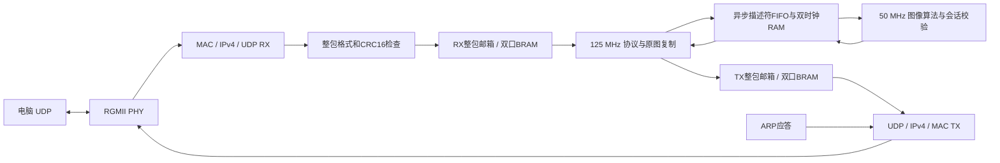

# ZU4EV 千兆以太网图像处理

本文记录首版移植的板卡和物理接口来源；当前v1.6使用64槽RX、8槽TX、默认32包/最多64包窗口，传输和算法均为125MHz，可回退到50MHz算法配置。跨时钟结构见[高速传输与算法跨时钟解耦](高速传输与算法跨时钟解耦.md)，当前频率以[算法125MHz提频](算法125MHz提频.md)为准。

目标：电脑经 PL 千兆网口上传图片，由 ZU4EV 完成原有八种图像处理、HOG 和 Band 解码，再通过同一网口回传。

## 硬件与时钟

器件沿用 ADC_ETH 的 `xczu4ev-sfvc784-2-i`，RGMII 管脚及电平以该工程 `eth.xdc` 为依据。PHY RXC 为125 MHz，BUFG 后驱动接收逻辑；Clocking Wizard 分别产生保留板卡相移的125 MHz发送时钟、50 MHz算法时钟，以及v1.5新增的0°相位125 MHz传输时钟。各域复位异步置位、同步释放，算法/网络复位还受 MMCM locked 限定。PHY复位直接使用外部按键，避免等待PHY提供时钟造成启动死锁。只支持协商到1000 Mbps的链路。

默认板卡IP为 `192.168.1.12/24`、UDP端口1234、MAC为 `02:55:49:4D:47:04`。电脑已配置 `192.168.1.18/24`；回复目的地址取自当前请求。无需修改系统网卡设置、PS或DDR。

## 模块连接

算法、指令、RGB565和灰度格式均继承UART_IMG。串口物理收发器不进入ZU4EV综合顶层。`img_stream_top`只封装现有字节协议与算法；`eth_image_core`负责GMII层及整包适配；`eth_img_top`负责时钟、复位和RGMII实例连接。

## 端口及时序

| 边界 | 信号 | 时钟域 | 约定 |
| --- | --- | --- | --- |
| PHY RX | eth_rxc / eth_rx_ctl / eth_rxd[3:0] | PHY125 MHz DDR | 上升沿低半字节、下降沿高半字节 |
| PHY TX | eth_txc / eth_tx_ctl / eth_txd[3:0] | TX125 MHz DDR | TX_CTL下降沿为EN xor ER |
| 包邮箱写侧 | start_valid/ready、length、peer、byte_valid/ready/data、finish、abort | RX或算法 | 完整写入并校验通过后才提交 |
| 包邮箱读侧 | packet_valid/ready、length、peer、sum、byte_valid/ready/data/last | 算法或TX | 仅valid和ready同时有效时前进 |
| 传输接口 | rx_data/valid/ready、tx_data/valid/ready、tx_start/length/done | 传输125 MHz | 完整包解析、编码与反压 |
| 算法接口 | 请求/应答/完成描述符FIFO、请求/结果双时钟RAM | 125 MHz ↔ 50 MHz | 描述符提交后转移RAM所有权，完成确认后才允许覆盖 |

RX状态为 `IDLE -> RECEIVE -> HOLD -> IDLE`。RECEIVE期间写入私有BRAM，长度、应用头和CRC16错误或MAC/IP/UDP校验失败则丢弃，只有包结束且全部校验通过才翻转提交标志。HOLD期间禁止覆盖，直到读侧消费last后返回确认。忙时到达的新包整包丢弃，电脑以同一序号重试。

读侧状态为 `IDLE -> WAIT_START -> READ -> IDLE`。同步器捕获提交后锁存稳定的长度、目的地址和checksum；收到packet_ready后同步读取BRAM，反压时保持data/valid/last；最后一个字节被接收时翻转确认。双向提交/确认至少两级同步，元数据和BRAM在整个未确认期间保持不变。

TX先收集整个应用应答并累计网络字节序16位反码和，再提交给发送域。发送域先锁存地址、长度和checksum，再连续提供负载，避免MAC发帧过程中等待算法。ARP按帧仲裁，不打断UDP帧。

## 网络协议与可靠性

每个UDP数据报严格包含一个完整的旧应用协议包：4字节magic、8字节字段、0～1024字节payload、2字节CRC16，最大1038字节，适配标准1500字节MTU。UDP报文不跨包拼接，不采用IP分片。MAC FCS、IPv4 checksum、UDP checksum、应用CRC16分别校验；发送端生成非零UDP checksum。支持ARP，不实现ICMP ping、DHCP或TCP。

上位机每次发一个请求并等待同会话/序号的回复；超时重发完全相同的请求。FPGA复用现有重试缓存，重复DATA/RUN/END不重复写入或计算，冲突重试返回错误。千兆是物理链路速率，实际图像吞吐受分包往返、算法及上位机影响，需实测报告。

## 验证顺序

1. 异步包邮箱：完整包、反压、校验失败、满邮箱、复位及边界长度。
2. GMII端到端：ARP、IP/UDP/FCS、应用CRC拒绝、错误目的地址、图像分包与重复请求。
3. 原有全部算法RTL与Python回归；新增UDP套接字、超时、源地址与包边界测试。
4. ZU4EV综合、布局布线、DRC、CDC和时序报告；核对综合层级符合本连接图。
5. JTAG识别器件后下载，使用test_img实际图片逐项比较FPGA结果与整数参考，并报告耗时/重试。

RGMII RXDLY/TXDLY沿用参考工程硬件假设，参考XDC未提供完整板级I/O delay；必须明确记录该限制，不能将内部时序通过表述为已完成PHY接口时序签核。必要时依据板卡strap/PHY寄存器及原理图补齐。
