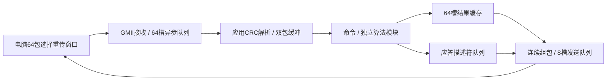

# 接收、计算、发送流水线与64包窗口

本文记录v1.3的流水线基础。v1.5已将传输域提升到125MHz并与50MHz算法域解耦，同时加入第65个暂存物理缓存槽；当前时钟和原子提交以[高速传输与算法跨时钟解耦](高速传输与算法跨时钟解耦.md)为准。

目标：保持全部算法与逐包CRC/有界重传行为，让下一包接收、当前包计算和上一包发送能够并行，提升1080p有效图像吞吐。

## 时钟、资源和模块

GMII收发125MHz、应用50MHz、低有效复位均保持原有配置。跨域仍使用整包Gray指针队列，接收扩为64槽；发送8槽。每槽2048字节，应用负载1024字节。

Band的512×512灰度帧由64个BRAM迁入UltraRAM：64位字、8个字节写使能，地址低三位选择字节，同步读取一拍。仅以太网配置启用，UART默认块RAM不变。该存储单独封装并验证任意地址字节写入与读取。

## 接口与生命周期

双包接收器沿用img_packet_rx。每个完整校验包提交一套命令、ID、序号、长度、CRC、96位端点及1024字节RAM；解析端和计算端分别占用独立bank。packet_valid/ready交付命令，packet_release_flag只在命令不再读取该bank后释放，禁止握手即覆盖。

普通DATA结果写入由序号低6位选择的64槽RAM。计算完成时把应答元数据提交8深描述符FIFO，下一拍向控制器返回resp_done并释放输入bank；发送器独立读取结果缓存。描述符同时保存端点，避免并行接收后把旧应答发给新端点。

每个已排队/正在发送的DATA槽有busy位，只有编码器完成后释放；同槽后续请求在入口反压，因此缓存回绕或重复请求不能破坏尚未发完的响应。缓存tag包含端点、ID、序号、长度及CRC；匹配重复只回放，冲突返回6。

非DATA与错误应答仍保持控制器占用至其响应编码完成，保证HOG/Band共享结果RAM和组合应答稳定。成功非DATA只使tag失效，不清除仍在发送的数据存储；busy保护继续有效。所有响应按接收命令顺序进入FIFO。

状态：输入IDLE→CHECK→FORWARD→WAIT_REPLY；成功DATA入队后FINISH→IDLE，其他控制应答入队后BLOCK_WAIT→IDLE；重复/能力/冲突走LOCAL_REQ，入队后直接释放输入。输出FIFO头直到resp_done才弹出，反压期间头部及缓存不变。

能力查询EWIN版本1、窗口64、最大负载1024；新版上位机默认请求32包（以实板复测择优）、支持请求1～64包并协商最小支持窗口，兼容旧8包/单包固件。窗口只在连续确认后滑动，已收到但前序缺失的结果继续占用槽；保留有限重试和取消语义。

## 验证

先测UltraRAM字节使能、双bank并行/满/CRC失败/复位、应答流水线与输出反压。GMII覆盖64包突发、跨64槽回绕、最早槽重发、乱序、冲突、端点隔离和会话失效，并证明接收/计算/发送有重叠。原算法回归后进行综合、布局布线、CDC/时序检查及实板窗口对比、丢包恢复、视频与frozen EXE验收。吞吐以完整1080p往返有效图像字节计，重传和数据一致性同时记录。
