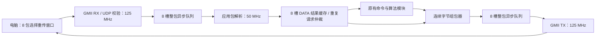

# 8 包窗口与连续字节通道

目标：在保持逐包 CRC、顺序处理和可重传语义的前提下，消除 1080p 原图传输每 1024 字节等待一次电脑往返的限制。

基线：1920×1080 RGB565，4,147,200 字节，4050 个 DATA 包，3.825 s；单图有效吞吐 8.673 Mbps。上传加回传合计吞吐为其两倍。

## 数据路径和时钟

全部复位低有效，同一外部复位异步置位、各时钟域同步释放。接收帧只有 Ethernet/IP/UDP 校验、应用长度和 CRC16 均通过后才提交队列。队列数据及描述符均由双时钟 XPM RAM 保存；提交/释放指针使用 Gray 编码和三级同步，满时整包丢弃，禁止发布半包。每槽 2048 字节，每方向 8 槽；窗口缓存为 8×1024 字节，不存整帧。

## 外部协议与窗口

- 原应用包格式、1024 字节上限和命令号保持兼容。新增 `0x05` 查询，响应 `0x85`、8 字节 `EWIN 01 08 00 04`，依次表示版本 1、窗口 8、最大负载 1024（小端）。不支持该命令的旧固件返回错误 1，客户端退回单包方式。
- START、END、HOG、Band 命令保持独立事务；普通图像的 DATA（包含滤波分片）使用窗口。每个 DATA 结果包兼作该请求的确认，无额外 ACK。
- 上位机最多保留 8 个未连续确认的序号，已收到但前面仍缺包的结果继续占用窗口。只有窗口头连续确认后才允许发送新序号，避免覆盖仍可能需要重发的 FPGA 缓存槽。
- FPGA 按到达顺序执行算法。已成功执行的窗口内重复 DATA 直接返回缓存结果；相同 ID/序号但长度或 CRC 不同返回错误 6。缓存键还包含发送端 MAC/IP/端口。
- 请求丢失或乱序导致的后续错误 4，由客户端保留这些请求并在超时后重发；错误包不推进窗口。其他协议错误立即终止。每包尝试次数有界，禁止无限等待。
- 成功的非 DATA 算法事务使窗口缓存失效；失败命令不破坏成功缓存。新 START 在旧 DATA 全部确认后发送。

## 接口和关键时序

| 模块/端口组 | 时钟域 | 握手及含义 |
|---|---|---|
| eth_packet_queue.wr_start_valid/ready、wr_length[15:0]、wr_peer[95:0] | 写时钟 | 锁定空闲槽与端点 |
| wr_byte_valid/ready、wr_byte_data[7:0] | 写时钟 | 每次握手写一个字节 |
| wr_finish_flag、wr_abort_en | 写时钟 | 最后字节之后完成；正确完整包才推进提交指针 |
| rd_packet_valid/ready、rd_length、rd_peer、rd_sum[31:0] | 读时钟 | 先读描述符，再发布包 |
| rd_byte_valid/ready、rd_byte_data、rd_byte_last | 读时钟 | 可连续一字节/拍，反压保持；末字节消费后释放槽 |
| img_response_cache 请求/应答接口 | app_clk | MISS 转发原控制器，HIT 从缓存回复，冲突返回错误 6 |
| img_packet_tx_fast.payload_addr[9:0]/data[7:0] | app_clk | 数据固定一拍读延迟，预取缓冲隔离输出反压 |

队列：`WR_IDLE → WR_DATA → WR_IDLE`，仅成功提交推进写指针；`RD_IDLE → RD_META → RD_WAIT → RD_DATA → RD_IDLE`，仅最后字节被消费推进读指针。

缓存：`IDLE → CHECK → FORWARD → WAIT_REPLY → IDLE`；命中/冲突/能力查询走 `CHECK → LOCAL_REQ → LOCAL_WAIT → IDLE`。请求元数据在整个事务内不变，缓存回放不重复执行算法。

原图：完成长度与会话验证后进入 `COPY_PRIME → COPY_RUN`，同步 RAM 预热一拍，随后每拍读写一个字节，最后一次写入才更新会话计数。

快速组包：头部期间预取，最多两字节就绪数据加一个在途 RAM 读取；只有 `valid && ready` 才消费输出并更新 CRC。非 RAM 类型的控制应答延迟一拍，与 RAM 数据保持同一接口时序。

## 验证要求

先验证异步队列的满、回绕、丢弃、反压与复位，以及快速组包的连续输出和停顿；再在 GMII 集成测试中覆盖窗口连续发送、请求/回包丢失、乱序、重复冲突及跨会话失效。电脑使用 UDP 模拟器验证选择重传和有界超时。原有算法回归、综合/布局布线/CDC、1080p 逐字节回传验收均通过后更新 EXE 与发布包。吞吐统一同时记录单图有效 Mbps 和双向负载合计 Mbps。
